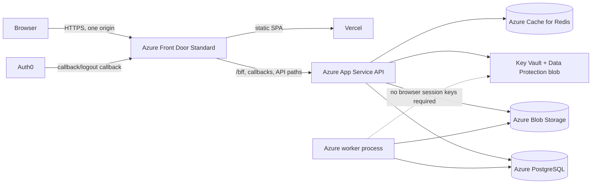

# CasePilot production Auth0/BFF deployment runbook

This document prepares deployment; it does not authorize resource creation,
DNS changes, Auth0 changes, user migration, or production database changes.

> **Architecture update:** Azure Front Door is deferred. The approved next
> staging topology serves React and ASP.NET Core from one Azure App Service
> origin. Follow `docs/AZURE_APP_SERVICE_COMBINED_DEPLOYMENT.md`. The Front Door
> material below is retained as a future scaling option, not a current
> deployment instruction.

## Verified repository architecture

- The React repository is a Vite SPA with a Vercel SPA fallback manifest. Its
  production Vercel project, domains, and environment variables are not
  represented in source control and require dashboard verification.
- The ASP.NET Core project has historical Visual Studio App Service publish
  profiles and ZIP artifacts. These are not reproducible production IaC.
- Both checked-out directories currently report the same GitHub remote. Treat
  their separate working trees carefully until repository ownership is clarified.
- The API supports PostgreSQL and Azure Blob Storage. The web role enqueues
  durable `IndexJobs`; the worker launched with `--worker` consumes the same
  PostgreSQL queue and Blob container. API and worker configuration must match.
- The current production domain, Azure subscription/resource group, Vercel
  project ownership, Auth0 production application, and DNS ownership are not
  proven by repository contents.
- Legacy JWT browser calls can use `VITE_API_BASE`. BFF mode deliberately uses
  relative URLs and requires one public origin.

## Recommended target

Azure Front Door Standard is the recommended first staging topology because it
provides a single HTTPS origin, deterministic path routing, long origin timeout,
and an Azure-supported way to restrict App Service to a specific Front Door.
Premium is justified only when managed WAF rules or Private Link are required.

The cheaper alternative is Vercel external rewrites directly to App Service.
It avoids the Front Door base fee but makes origin restriction, proxy timeout,
large-upload, Range, and SSE behavior more dependent on the Vercel plan. It is
acceptable for a staging experiment, not the recommended production baseline
until those limits are contractually verified.

Serving the compiled React app from ASP.NET Core is the lowest-complexity
same-origin option, but it gives up the current Vercel deployment workflow and
requires a separate frontend release pipeline. Keep it as the fallback design.

## Required cloud resources

1. Existing or new Azure resource group in the approved subscription.
2. Azure Front Door Standard profile, endpoint, API origin group, and Vercel
   origin group. `infra/frontdoor/main.bicep` is parameterized and creates no
   custom domain or DNS records.
3. Azure App Service web role with system- or user-assigned managed identity.
4. A separately scalable worker host using the same build and `--worker`.
5. Azure Database for PostgreSQL and a least-privilege application identity or
   secret reference.
6. Azure Storage containers for documents and Data Protection keys.
7. Azure Key Vault with a versionless wrapping-key URI.
8. Redis for distributed rate limiting before more than one API instance.
9. Application Insights or an OTLP-compatible destination.
10. A verified public domain and DNS zone, or the generated `azurefd.net`
    hostname for staging only.

## Origin and proxy controls

- Configure Front Door with the Bicep route inventory and a 240-second origin
  response timeout. AI endpoints should emit periodic SSE data; jobs expected to
  exceed the timeout must remain asynchronous.
- Do not enable Front Door caching for `/bff`, callbacks, APIs, PDFs, downloads,
  or streams. The application also returns `Cache-Control: no-store` for
  authenticated and authentication responses.
- Configure App Service access restrictions for the
  `AzureFrontDoor.Backend` service tag plus the exact `X-Azure-FDID` value.
  Set the unmatched action to Deny. Apply an equivalent restriction to the SCM
  endpoint or explicitly document the deployment exception.
- Set `TRUST_FORWARDED_HEADERS=true` and `AZURE_FRONT_DOOR_ID` only after those
  access restrictions exist. Production startup fails if proxy trust is enabled
  without the Front Door ID.
- Preserve `Range`, `If-Range`, `Content-Range`, `Origin`, `Referer`,
  `X-CSRF-TOKEN`, and streaming response semantics. Validate a PDF partial
  request and an SSE cancellation through the public staging origin.
- No current feature requires WebSockets; re-evaluate if a future real-time
  transport changes from SSE.

## Auth0 application checklist

Create a separate **Regular Web Application** for staging and production.
For public origin `https://PUBLIC_ORIGIN`, configure exact values:

- Allowed Callback URLs: `https://PUBLIC_ORIGIN/signin-auth0`
- Allowed Logout URLs: `https://PUBLIC_ORIGIN/signout-callback-auth0`
- Allowed Web Origins: `https://PUBLIC_ORIGIN`
- Authorization Code flow enabled; confidential client authentication enabled.
- No SPA access token flow is required for the same-process BFF/API.
- Store Domain, Client ID, and Client Secret in App Service configuration/Key
  Vault references. Never put the client secret in Vercel or a `VITE_*` value.

The application keeps PKCE, state, nonce, correlation cookies, `SaveTokens=false`,
host-only Secure/HttpOnly cookies, CSRF validation, and strict local redirect
validation. `/bff/*` is canonical. `/bff/dev/*` exists only in Development.

## Data Protection and managed identity

Set `DATA_PROTECTION_BLOB_URI` to an HTTPS blob URI without SAS parameters and
`DATA_PROTECTION_KEY_VAULT_KEY_ID` to a versionless `/keys/{name}` URI. Grant the
App Service identity Blob Data Contributor scoped to the key container and Key
Vault Crypto User (or equivalent Get/Wrap/Unwrap permissions) scoped to the key.
Set `AZURE_CLIENT_ID` only for a user-assigned identity.

Keep old Key Vault key versions enabled and retained longer than the longest
cookie plus rollback window. Blob soft delete/versioning and Key Vault purge
protection are required recovery controls. Use the same Data Protection blob,
Key Vault key, and application name across instances and deployment slots that
must accept the same sessions. A slot intentionally isolated for staging must
use a different blob/key.

## User cutover

- Never change `Users.Id`; `UserIdentities` maps Auth0 `sub` values to them.
- Never bulk-link by email. Existing users must prove ownership with a still-valid
  legacy credential/session or be linked by a trusted audited administrator.
- New verified-email users may be provisioned only when
  `AUTH0_STUDENT_REGISTRATION_ENABLED=true`; provisioning creates students only.
- Instructor privilege continues to require invitation/approval in the local
  database. Auth0 claims cannot assign it.
- Existing hashes are BCrypt (`$2a$`, `$2b$`, or `$2y$`) when reported as such.
  Auth0 bulk import/hash compatibility and automatic migration must be validated
  in a disposable tenant before any export approval. Password reset is the safer
  fallback for incompatible records.
- Run `--auth0-migration-report` first. It emits aggregate counts only and is
  idempotent/read-only. Archive the report with the release evidence.

## Database migration procedure

1. Take a PostgreSQL backup and Blob inventory; record recovery points.
2. Run the complete test suite against an isolated database.
3. Review additive schema SQL and dry-run reports. The current startup-DDL
   convention remains a blocker for uncontrolled future schema evolution;
   introduce reviewed versioned migrations before the next destructive change.
4. Apply schema changes to staging, start one API instance, then one worker.
5. Verify `/health/ready`, queue claims, Blob access, and identity mappings.
6. Never run `--migrate-sqlite-to-postgres` against a populated target: the
   current utility clears target tables and therefore requires separate explicit
   migration approval and a disposable/empty target.

## Staging validation

- [ ] Public origin is HTTPS and Auth0 URLs match exactly.
- [ ] Direct App Service requests are denied; Front Door requests succeed.
- [ ] Login, refresh restoration, unlinked, disabled, and deleted-user states.
- [ ] Student and instructor authorization and cross-user 404 behavior.
- [ ] Missing/invalid CSRF and Origin are rejected before mutations.
- [ ] Upload at configured maximum size; worker completes indexing.
- [ ] PDF `Range: bytes=0-1023` returns 206 with correct headers.
- [ ] Notes, sessions, classes, tutor, AI SSE, cancellation, and logout.
- [ ] Two API instances decrypt the same cookie before and after restart/slot swap.
- [ ] Role changes and suspension take effect on the next protected request.
- [ ] PostgreSQL, Blob, Redis, Key Vault, Auth0, and worker failure alerts.
- [ ] Capacity ladder is executed only against approved production-sized staging.

## Cutover and rollback

1. Freeze schema/user-linking changes and take backups.
2. Deploy backend with Auth0 and legacy JWT both enabled.
3. Deploy frontend with `VITE_AUTH_MODE=bff` behind the public origin.
4. Validate synthetic student/instructor journeys, then enable a small cohort.
5. Keep JWT secrets and legacy endpoints available during the defined rollback
   window; do not issue browser JWTs in BFF mode.
6. Roll back by restoring the previous frontend build (`VITE_AUTH_MODE=jwt`) and
   backend slot while retaining database additions. Do not delete mappings or
   rotate Data Protection/Auth0 secrets during an application rollback.
7. Disable legacy JWT issuance only after the cohort, monitoring, support, and
   rollback criteria have been approved.

## Monitoring and incident response

Alert on authentication callback failures, CSRF/origin rejections, 401/403/404
rate changes, session validation failures, Key Vault/Blob key-ring failures,
PostgreSQL/Redis readiness, index queue age/depth, upload failures, AI latency and
token cost, SSE disconnects, and Front Door/App Service 4xx/5xx. Logs must contain
request IDs and local user IDs only where operationally necessary; never log
cookies, authorization codes, tokens, client secrets, password hashes, PDF
contents, prompts, or Auth0 subjects in browser responses.

## Approval gates

Explicit approval is still required for subscription/resource selection, paid
resource creation, DNS/custom-domain ownership, Front Door/App Service access
restrictions, Vercel production settings, Auth0 dashboard changes, Key Vault/RBAC,
production secrets, database migrations, real-user linking/import, staging load
tests, deployment, cutover, and legacy JWT retirement.

## Runtime support gate

The backend currently targets `net9.0` and the repository pins the .NET 9 SDK.
Microsoft support for .NET 9 ends on November 10, 2026. Do not schedule the
production cutover on this runtime. Upgrade the backend and test projects to
.NET 10 LTS in a separate, reviewable change, then repeat the full backend suite,
package vulnerability scan, App Service startup validation, and staging smoke
tests before production approval.

The local build environment now has a .NET 10 SDK, but this combined-hosting PR
intentionally does not mix a runtime upgrade into the deployment-packaging
change. Upgrade the backend and test projects in a separate, reviewable PR and
repeat the complete verification before production cutover.
